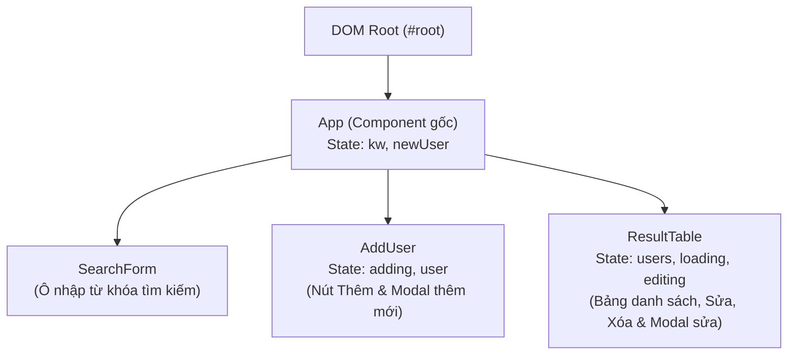
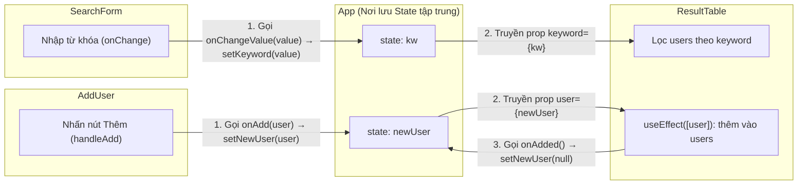

# BÁO CÁO KẾT QUẢ BÀI TẬP: ỨNG DỤNG QUẢN LÝ NGƯỜI DÙNG (REACT CRUD)

## Giới thiệu chung

Ứng dụng **Quản lý người dùng (React CRUD)** được xây dựng bằng React 18 (nhúng qua CDN cùng ReactDOM và Babel) gồm các tệp:
- `index.html`: Chứa cấu trúc trang và mã nguồn React cho 4 Functional Component (`App`, `SearchForm`, `AddUser`, `ResultTable`).
- `style.css`: Định dạng giao diện bảng dữ liệu, thanh tìm kiếm và Modal Form thêm/sửa người dùng.

Ứng dụng hỗ trợ đầy đủ các chức năng CRUD và tìm kiếm:
- **Read**: Tải danh sách người dùng từ API `https://jsonplaceholder.typicode.com/users` bằng `useEffect`.
- **Search**: Lọc danh sách theo `name` và `username` theo thời gian thực.
- **Create**: Thêm người dùng mới qua Modal Form (bao gồm cả thuộc tính lồng `address`).
- **Update**: Chỉnh sửa thông tin người dùng bằng kỹ thuật Deep Copy và Modal Form.
- **Delete**: Xóa trực tiếp người dùng khỏi danh sách bằng `Array.filter()`.

---

## 1. Sơ đồ Component (Component Tree)

Ứng dụng được tổ chức theo kiến trúc phân cấp với 1 component gốc (`App`) và 3 component con ngang hàng (`SearchForm`, `AddUser`, `ResultTable`):



**Vai trò từng Component:**
- **`App`**: Component cha cao nhất, giữ các state dùng chung (`kw`, `newUser`) và điều phối dữ liệu giữa các component con.
- **`SearchForm`**: Hiển thị ô tìm kiếm, bắt sự kiện `onChange` và gửi từ khóa ngược lên `App`.
- **`AddUser`**: Quản lý trạng thái mở/đóng form và dữ liệu nhập của người dùng mới, sau đó gửi object người dùng mới lên `App`.
- **`ResultTable`**: Tải dữ liệu từ API, lọc theo `keyword`, nhận `user` mới để thêm vào danh sách, đồng thời xử lý trực tiếp thao tác Sửa (Update) và Xóa (Delete).

---

## 2. Sơ đồ luồng dữ liệu (State Lifting)

### 2.1. Sơ đồ luồng dữ liệu hai chiều (Callback lên cha – Props xuống con)



### 2.2. Giải thích tại sao `kw` và `newUser` được đặt ở `App` mà không đặt ở `SearchForm` hay `AddUser`?

Trong React, **luồng dữ liệu chỉ đi một chiều từ cha xuống con (One-way Data Flow)** thông qua `props`. Các component ngang hàng (sibling components) như `SearchForm`, `AddUser` và `ResultTable` **không thể trực tiếp đọc hoặc truyền state cho nhau**.

1. **Đối với state `kw` (từ khóa tìm kiếm):**
   - `SearchForm` là nơi **tạo/thay đổi** từ khóa tìm kiếm, nhưng `ResultTable` mới là nơi **sử dụng** từ khóa đó để lọc mảng `users`.
   - Nếu đặt `kw` bên trong `SearchForm`, `ResultTable` sẽ không thể truy cập `kw` để lọc bảng.
   - Do đó, ta áp dụng kỹ thuật **State Lifting (Nâng state lên component cha chung gần nhất là `App`)**: `App` giữ `kw`, truyền hàm cập nhật `setKeyword` xuống `SearchForm` qua prop `onChangeValue`, và truyền giá trị `kw` xuống `ResultTable` qua prop `keyword`.

2. **Đối với state `newUser` (người dùng mới):**
   - `AddUser` là nơi **thu thập dữ liệu** người dùng mới từ form, nhưng danh sách `users` lại nằm ở `ResultTable`.
   - Nếu chỉ giữ dữ liệu người dùng mới trong `AddUser`, `ResultTable` sẽ không biết khi nào có người dùng mới để cập nhật bảng.
   - Khi nâng `newUser` lên `App`: `AddUser` gọi callback `onAdd(user)` để cập nhật `newUser` tại `App`; `App` truyền `newUser` xuống `ResultTable` qua prop `user` cùng callback `onAdded` để reset `newUser` về `null` sau khi đã thêm thành công.

Nhờ **State Lifting**, `App` trở thành **nguồn dữ liệu chân lý duy nhất (Single Source of Truth)** cho các dữ liệu chia sẻ giữa các component con, giúp luồng dữ liệu rõ ràng, dễ kiểm soát và dễ debug.

---

## 3. Mô tả Props truyền từ `App` xuống các Component con

| Component nhận | Tên Prop | Kiểu dữ liệu | Giá trị truyền từ `App` | Mục đích / Vai trò |
| :--- | :--- | :--- | :--- | :--- |
| `SearchForm` | `onChangeValue` | `Function` | `setKeyword` | Callback cập nhật state `kw` ở `App` mỗi khi người dùng gõ vào ô tìm kiếm. |
| `AddUser` | `onAdd` | `Function` | `setNewUser` | Callback truyền đối tượng người dùng mới từ form `AddUser` lên state `newUser` ở `App`. |
| `ResultTable` | `keyword` | `String` | `kw` | Từ khóa tìm kiếm dùng để lọc danh sách `users` theo `name` hoặc `username`. |
| `ResultTable` | `user` | `Object \| null` | `newUser` | Đối tượng người dùng mới được gửi từ `App`; kích hoạt `useEffect` để thêm vào mảng `users`. |
| `ResultTable` | `onAdded` | `Function` | `handleAdded` (`() => setNewUser(null)`) | Callback báo cho `App` biết đã thêm xong người dùng mới để reset `newUser` về `null`, tránh thêm lặp lại. |

---

## 4. Lỗi (Warning / Error) gặp phải trong quá trình lập trình và cách khắc phục

### Lỗi 1: Gọi trực tiếp hàm `setState` trong thuộc tính `onClick` (Lỗi Error khi render)

- **Hiện tượng sai / Thông báo lỗi:**
  Khi nhấn nút **Thêm** để mở Modal thêm người dùng trong `AddUser`, Modal không hiển thị (hoặc tự đóng ngay lập tức) và trình duyệt báo lỗi trong Console:
  > `Warning: Cannot update a component (AddUser) while rendering a different component...`
  > hoặc: `Uncaught Error: Too many re-renders. React limits the number of renders to prevent an infinite loop.`

- **Đoạn mã gây lỗi (theo mã minh họa ở Bước 5):**
  ```jsx
  <button onClick={setAdding(false)}>Hủy</button>
  ```

- **Nguyên nhân:**
  Cú pháp `onClick={setAdding(false)}` **thực thi ngay lập tức** hàm `setAdding(false)` trong quá trình React đang render JSX thay vì truyền một hàm callback để chạy khi người dùng click. Khi `adding` chuyển thành `true`, React render Modal → gặp `setAdding(false)` → gọi ngay lập tức → cập nhật state trong lúc render.

- **Cách sửa:**
  Bọc lệnh gọi hàm trong một Arrow Function (hoặc truyền tham chiếu hàm `handleCancel`) để chỉ chạy khi sự kiện click xảy ra:
  ```jsx
  <button onClick={() => setAdding(false)}>Hủy</button>
  ```

---

### Lỗi 2: Trùng `key` trong danh sách sau khi Xóa rồi Thêm mới (Warning của React)

- **Hiện tượng sai / Thông báo lỗi:**
  Khi xóa một người dùng bất kỳ (ví dụ xóa user có `id = 2`, danh sách còn 9 người với `id` lớn nhất là `10`), sau đó thêm một người dùng mới, trình duyệt hiện cảnh báo trong Console:
  > `Warning: Encountered two children with the same key, '10'. Keys should be unique so that components maintain their identity across updates.`
  Đồng thời khi bấm Sửa hoặc Xóa user có `id = 10` sẽ làm ảnh hưởng nhầm cả hai dòng bị trùng `id`.

- **Đoạn mã gây lỗi:**
  ```jsx
  setUsers((prev) => [...prev, { ...user, id: prev.length + 1 }]);
  ```

- **Nguyên nhân:**
  Cách tính `id: prev.length + 1` chỉ đúng khi danh sách chưa từng bị xóa phần tử nào. Khi xóa 1 phần tử trong 10 phần tử ban đầu, `prev.length` giảm xuống `9`, nên `prev.length + 1 = 10` bị trùng với `id = 10` đang tồn tại trong bảng.

- **Cách sửa:**
  Tính `id` mới dựa trên giá trị `id` lớn nhất hiện có trong mảng `prev` cộng thêm 1:
  ```jsx
  setUsers((prev) => {
    const nextId = prev.length > 0 ? Math.max(...prev.map((u) => u.id)) + 1 : 1;
    return [...prev, { ...user, id: nextId }];
  });
  ```
